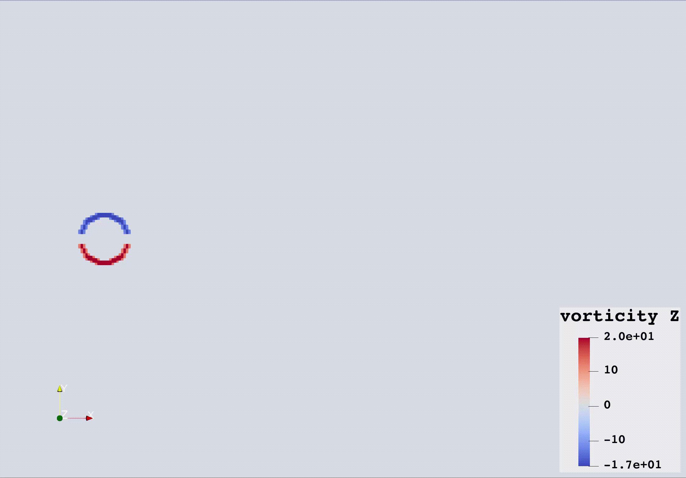
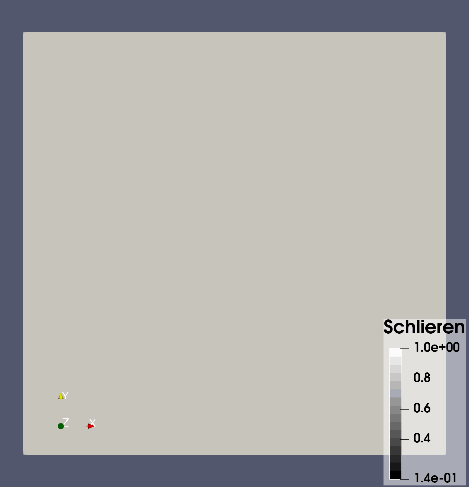
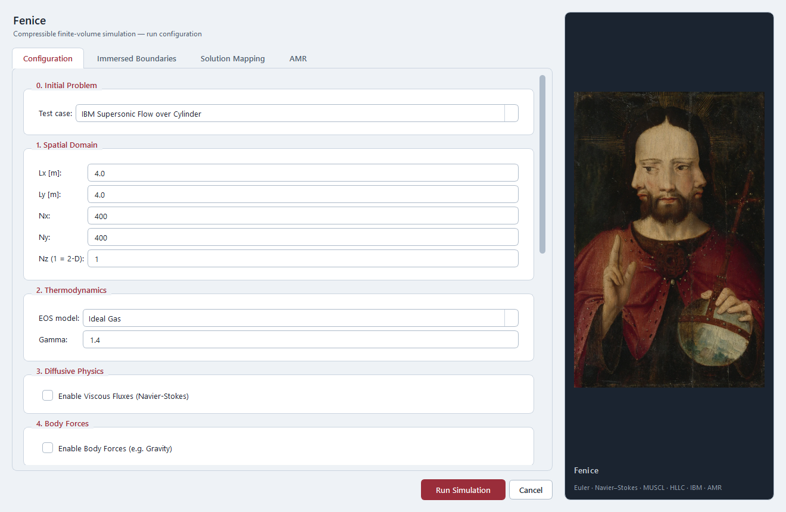
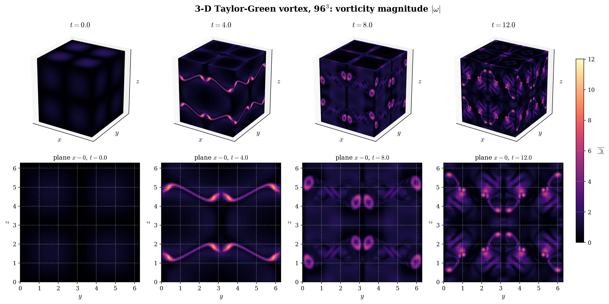

# Fenice

**Fenice** (Italian for *phoenix*) is a compressible finite-volume solver for the Euler
and Navier-Stokes equations on structured Cartesian grids, in 2-D and 3-D. It is written
in C++17 with OpenMP threading and MPI domain decomposition, and comes with a PyQt6 setup
GUI, validation scripts and full documentation.

<p align="center">
  
  
</p>
<p align="center">
  <em>Left: von Kármán vortex street behind a cylinder at Re = 100 (vorticity).
  Right: Mach 2 flow over a cylinder, with its bow shock (numerical schlieren).
  Both use the immersed boundary method.</em>
</p>

## Features

- **Riemann solvers:** HLLC, Low-Mach HLLC (Thornber) and preconditioned HLLC (Weiss-Smith).
- **Reconstruction:** 2nd-order MUSCL with Minmod, Van Leer, MC and Koren limiters.
- **Physics:** ideal and stiffened-gas equations of state, Navier-Stokes viscous and heat
  fluxes, body forces, and an immersed boundary method (cylinder or sphere).
- **Time integration:** Explicit Euler, SSP-RK2, RK4, and BDF2 with dual time stepping.
- **Meshes:** uniform 2-D (`nz = 1`) or 3-D (`nz > 1`) grids, plus block-structured AMR in
  2-D with subcycling, refluxing and 2:1 balance.
- **Boundary conditions:** slip and no-slip walls, moving walls, velocity and mass-flow
  inlets, pressure outlets, transmissive and periodic.
- **Parallelism:** OpenMP everywhere, plus MPI strips whose results match the serial run
  exactly.
- **I/O:** VTK output for ParaView, `.npz` checkpoints with restart, and hot start that maps
  a solution onto a different resolution.

## Build

The solver is built with CMake. OpenMP and MPI are optional: if either is missing, CMake
prints a warning and builds without it (single-threaded, or serial only).

### Windows

Requirements: Visual Studio 2022 or newer with the *Desktop development with C++*
workload (it provides MSVC, CMake and Ninja). For MPI, also install the MS-MPI runtime and
SDK: `winget install Microsoft.msmpi Microsoft.msmpisdk`.

```powershell
.\cpp\build.ps1 -Test        # Release build + unit tests -> cpp\build\fenice.exe
.\cpp\build.ps1 -NoMpi       # OpenMP only
```

### Linux

Requirements (Debian / Ubuntu shown): a C++17 compiler, CMake ≥ 3.20 and, for MPI,
Open MPI or MPICH.

```bash
sudo apt install build-essential cmake libopenmpi-dev openmpi-bin
cmake -S cpp -B cpp/build -DCMAKE_BUILD_TYPE=Release
cmake --build cpp/build -j
./cpp/build/fenice_tests     # unit tests
```

### macOS

Apple's clang has no built-in OpenMP, so install Homebrew's `libomp` and point CMake at it:

```bash
xcode-select --install
brew install cmake libomp open-mpi
LIBOMP=$(brew --prefix libomp)
cmake -S cpp -B cpp/build -DCMAKE_BUILD_TYPE=Release \
      -DOpenMP_CXX_FLAGS="-Xpreprocessor -fopenmp -I$LIBOMP/include" \
      -DOpenMP_CXX_LIB_NAMES=omp -DOpenMP_omp_LIBRARY=$LIBOMP/lib/libomp.dylib
cmake --build cpp/build -j
./cpp/build/fenice_tests     # unit tests
```

Add `-DFV_USE_MPI=OFF` or `-DFV_USE_OPENMP=OFF` to the configure line to leave either out.

> Windows (MSVC) is the platform Fenice is developed and tested on. The Linux and macOS
> builds use the same portable CMake setup but have not been tested yet.

## Run

Every run is a test case plus optional parameter overrides. Parameters come from the case
defaults, then a `--config` file (`key = value` lines), then `--set key=value`.

**Windows**

```powershell
cpp\build\fenice.exe --list-cases
cpp\build\fenice.exe --case "Sod Shock Tube"
cpp\build\fenice.exe --case "Shu-Osher Test" --set nx=4000 --set muscl_limiter=MC
cpp\build\fenice.exe --case "Taylor-Green Vortex 3D" --set monitor_interval=10
cpp\build\fenice.exe --config run.cfg --threads 8
mpiexec -n 8 cpp\build\fenice.exe --case "IBM Supersonic Flow over Cylinder"
```

**Linux / macOS**

```bash
./cpp/build/fenice --list-cases
./cpp/build/fenice --case "Sod Shock Tube"
./cpp/build/fenice --case "Shu-Osher Test" --set nx=4000 --set muscl_limiter=MC
./cpp/build/fenice --case "Taylor-Green Vortex 3D" --set monitor_interval=10
./cpp/build/fenice --config run.cfg --threads 8
mpiexec -n 8 ./cpp/build/fenice --case "IBM Supersonic Flow over Cylinder"
```

With `--set use_mpi=true --set n_cpus=N` the solver re-launches itself under `mpiexec`,
so you don't have to call it yourself. Output goes to `results/<case>/`: `.vtr` snapshots
plus a `.pvd` time series (open it in ParaView) and a restart checkpoint. Ctrl+C stops a
run cleanly and saves the checkpoint.

## GUI

<p align="center">
  
</p>

The PyQt6 setup dialog configures a run and launches the solver. Its tabs:

- **Configuration:** test case, mesh (setting Nz > 1 makes the run 3-D), thermodynamics,
  viscosity, body forces, boundary conditions, numerical schemes, output and MPI ranks.
- **Immersed Boundaries:** obstacle shape, radius and position.
- **Solution Mapping:** hot start from a saved checkpoint.
- **AMR:** refinement levels, patch size and thresholds.

The list of test cases and their defaults come from the solver itself, so new cases appear
in the GUI automatically. Build the solver first, then:

```bash
python prerequisites.py      # one-time: PyQt6, numpy, matplotlib, markdown2 (python3 on Linux / macOS)
python gui/run.py
```

## Test cases

| Case | Validates |
|---|---|
| Sod Shock Tube | Riemann solvers, limiters, MPI, AMR |
| Poiseuille Flow | Viscous fluxes, inlet / outlet BCs, BDF2 |
| Lid Driven Cavity | 2-D Navier-Stokes at Re = 400 vs Ghia et al. (1982) |
| IBM Flow over Cylinder | IBM, vortex shedding at Re = 100, hot start |
| Shu-Osher Test | Shock / entropy-wave interaction |
| IBM Supersonic Flow over Cylinder | IBM at Mach 2, bow shock |
| Taylor-Green Vortex | Viscous decay vs the exact solution |
| Isentropic Vortex | 2nd-order accuracy on smooth advection |
| Taylor-Green Vortex 3D | 3-D transition to turbulence at Re = 1600 |

<p align="center">
  
</p>

## Testing

```bash
cpp/build/fenice_tests                   # unit tests (fenice_tests.exe on Windows)
python cpp/tests/regression.py --mpi 4   # compare against the stored reference states
```

`cpp/tests/reference/` holds the final states of 24 reference configurations; every
change to the code must reproduce them (serial and on MPI ranks).

## Documentation

The HTML documentation is in [`docs/`](docs/index.html): open `docs/index.html` locally,
or rebuild it with `python docs/build.py --open`. It covers the governing equations, every
module, all parameters, and a validation page per test case.

## License

[MIT](LICENSE) © 2026 Edoardo Taglialatela
