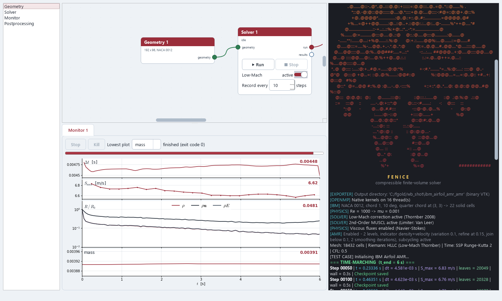
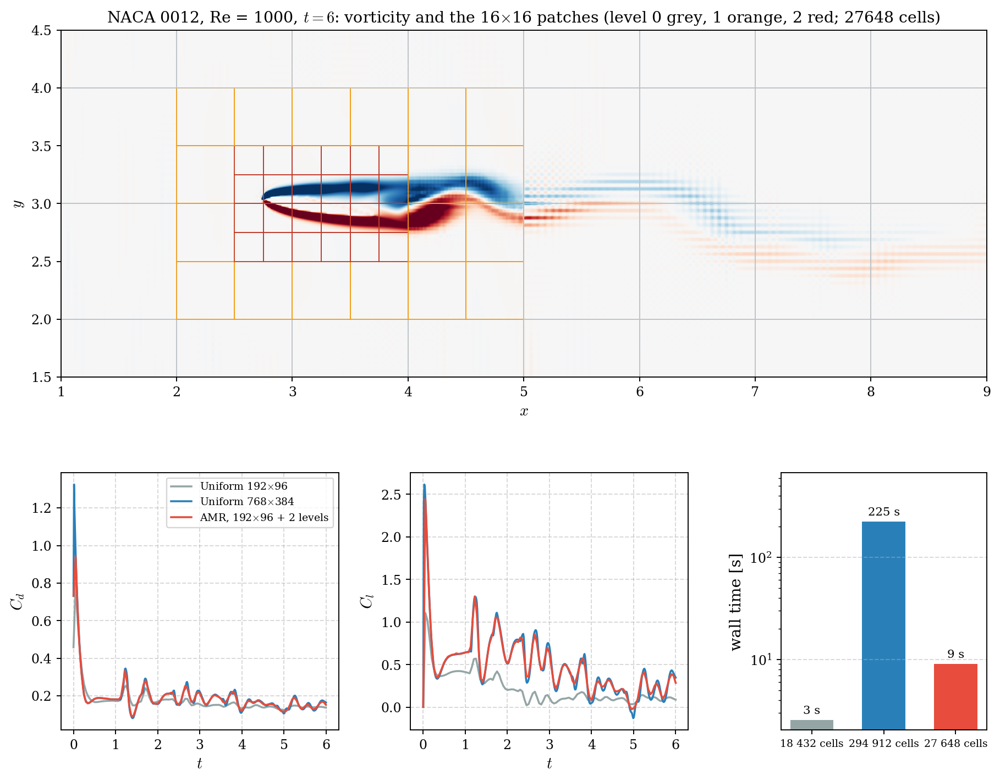

# Fenice

[](https://github.com/edotaglialatela/fenice/actions/workflows/ci.yml)

**Fenice** (Italian for *phoenix*) is a compressible finite-volume solver for the Euler
and Navier-Stokes equations on structured Cartesian grids, in 2-D and 3-D. It is written
in C++17 with OpenMP threading and MPI domain decomposition, and comes with a PyQt6 setup
GUI, validation scripts and full documentation.

<p align="center">
  
  
</p>
<p align="center">
  <em>Left: von Kármán vortex street behind a cylinder at Re = 100 (vorticity, 1200 × 600
  cells, one shedding period). Right: Mach 2 flow over a cylinder forming its bow shock
  (numerical schlieren, 1200 × 1200 cells). Both use the immersed boundary method.</em>
</p>

## Features

- **Riemann solvers:** HLLC, Low-Mach HLLC (Thornber) and preconditioned HLLC (Weiss-Smith).
- **Reconstruction:** 2nd-order MUSCL with Minmod, Van Leer, MC and Koren limiters.
- **Physics:** ideal and stiffened-gas equations of state, Navier-Stokes viscous and heat
  fluxes, body forces, and an immersed boundary method (cylinder, sphere, or an airfoil from
  the NACA 4-digit formulas or a coordinate file), with lift / drag monitoring.
- **Time integration:** Explicit Euler, SSP-RK2, RK4, and BDF2 with dual time stepping.
- **Meshes:** uniform 2-D (`nz = 1`) or 3-D (`nz > 1`) grids, plus cell-based AMR in
  2-D with subcycling, conservative flux replacement and 2:1 balance.
- **Boundary conditions:** slip and no-slip walls, moving walls, velocity and mass-flow
  inlets, pressure outlets, transmissive and periodic.
- **Parallelism:** OpenMP everywhere, plus MPI (strips of rows or columns; for AMR, the
  leaves distributed over the ranks along a Morton curve). MPI results match the serial run
  exactly for any number of ranks.
- **I/O:** VTK output for ParaView, `.npz` checkpoints with restart, and hot start that maps
  a solution onto a different resolution.

## Build

The solver is built with CMake. OpenMP and MPI are optional: if either is missing, CMake
prints a warning and builds without it (single-threaded, or serial only).

### Windows

Requirements: Visual Studio 2022 or newer with the *Desktop development with C++*
workload (it provides MSVC, CMake and Ninja). For MPI, also install the MS-MPI runtime and
SDK: `winget install Microsoft.msmpi Microsoft.msmpisdk`.

```powershell
.\cpp\build.ps1 -Test        # Release build + unit tests -> build\release\fenice.exe
.\cpp\build.ps1 -NoMpi       # OpenMP only
```

### Linux

Requirements (Debian / Ubuntu shown): a C++17 compiler, CMake ≥ 3.25, Ninja and, for MPI,
Open MPI or MPICH.

```bash
sudo apt install build-essential cmake ninja-build libopenmpi-dev openmpi-bin
cmake --preset release
cmake --build --preset release
./build/release/fenice_tests     # unit tests
```

### macOS

Apple's clang has no built-in OpenMP; CMake picks up Homebrew's `libomp` automatically:

```bash
xcode-select --install
brew install cmake ninja libomp open-mpi
cmake --preset release
cmake --build --preset release
./build/release/fenice_tests     # unit tests
```

Add `-DFV_USE_MPI=OFF` or `-DFV_USE_OPENMP=OFF` to the configure line to leave either out.
Every build goes to `build/release/` (or `build/debug/` with the `debug` preset).

The Python tools (GUI, validation, docs, regression) share a small package in `python/`;
`python prerequisites.py` installs it together with their dependencies.

### IDEs (CLion, VS Code, Visual Studio)

The repository root is a CMake project with two presets (`CMakePresets.json`), the same on
every OS: `release` (into `build/release/`) and `debug` (into `build/debug/`). `build.ps1`
uses `release`. On Windows run the presets from a Visual Studio developer prompt, or pick the
Visual Studio toolchain in the IDE. In CLion the presets appear as CMake profiles, and `.run/`
provides ready-made run configurations: Sod, 3-D Taylor-Green, unit tests, regression and the GUI.

> **Tested platforms:** Windows 11 (MSVC 19.50, MS-MPI 10.1), Ubuntu 26.04 (GCC 15.2,
> Open MPI 5.0) and macOS 27 on Apple M4 (Apple clang 21.0, Homebrew libomp, Open MPI
> 5.0.9). On all three, every unit test passes and the regression suite reproduces the
> reference states bit for bit, serial and on 4 MPI ranks. GitHub Actions repeats this on
> every push on Linux x64 and ARM64, macOS and Windows (`.github/workflows/ci.yml`).

## Run

Every run is a test case plus optional parameter overrides. Parameters come from the case
defaults, then a `--config` file (`key = value` lines), then `--set key=value`.

**Windows**

```powershell
build\release\fenice.exe --list-cases
build\release\fenice.exe --case "Sod Shock Tube"
build\release\fenice.exe --case "Shu-Osher Test" --set nx=4000 --set muscl_limiter=MC
build\release\fenice.exe --case "Taylor-Green Vortex 3D" --set monitor_interval=10
build\release\fenice.exe --config run.cfg --threads 8
mpiexec -n 8 build\release\fenice.exe --case "IBM Supersonic Flow over Cylinder"
```

**Linux / macOS**

```bash
./build/release/fenice --list-cases
./build/release/fenice --case "Sod Shock Tube"
./build/release/fenice --case "Shu-Osher Test" --set nx=4000 --set muscl_limiter=MC
./build/release/fenice --case "Taylor-Green Vortex 3D" --set monitor_interval=10
./build/release/fenice --config run.cfg --threads 8
mpiexec -n 8 ./build/release/fenice --case "IBM Supersonic Flow over Cylinder"
```

With `--set use_mpi=true --set n_cpus=N` the solver re-launches itself under `mpiexec`,
so you don't have to call it yourself. Output goes to `results/<case>/`: `.vtr` snapshots
plus a `.pvd` time series (open it in ParaView) and a restart checkpoint. Ctrl+C stops a
run cleanly and saves the checkpoint.

## GUI

<p align="center">
  
</p>

The PyQt6 **workbench** is an empty canvas of modules that you drag from the palette and link port to port
(a link that does not fit is refused; *Delete* removes the selection). A new workbench holds a *Geometry*
node linked to a *Solver* node; double-click a node to open its editor in a window of its own.

- **Geometry:** the domain, base mesh (with *2×* / *½×* for a grid study), immersed body (cylinder, sphere,
  NACA section, airfoil file), the boundary condition of each side, the adaptive mesh (levels, indicator
  variables, thresholds, remesh interval; starts with all three variables, thresholds 0.11, every step) and a
  picture of the solid cells on every AMR level. It owns its geometry and can be edited before it is linked; a solver does not run without one.
- **Solver:** the setup (test case, thermodynamics, viscosity, body forces, numerical schemes, output, MPI
  ranks, hot start) without the geometry, plus *Run* / *Stop* (a clean stop that saves the checkpoint),
  a **Low-Mach** slider and the monitor interval on the node itself. Several solvers can run at once.
- **Monitor** (link a solver's *run* port): live panels for the time step, the wave speed, the residuals
  (log axis) and one monitor quantity, with the name and latest value written inside each panel, and a
  progress bar. The solver's console, coloured, is a column on the right of the window. A monitor linked in
  the middle of a run shows it from its start.
- **Postprocessing** (link a solver's *results* port): the result viewer, following the run while it goes on.

The list of test cases and their defaults come from the solver itself, so new cases appear in the GUI
automatically. Build the solver first, then:

```bash
python prerequisites.py      # one-time: PyQt6, numpy, matplotlib, markdown2 (python3 on Linux / macOS)
python gui/workbench.py
```

The original single-window **setup dialog** is still there and launches the solver in the terminal; it
holds the geometry too (mesh, boundaries, immersed body) in its tabs: *Configuration*, *Immersed
Boundaries*, *Solution Mapping* (hot start) and *AMR*; its AMR fields start at the same values.

```bash
python gui/run.py
```

## Test cases

Every test case is a folder under [`cases/`](cases/) holding one `case.toml`. That file
sets the mesh, physics, numerics, boundary conditions, run control and initial
conditions, so adding a case needs no C++ and no recompilation. The shipped cases:

| Case | Validates |
|---|---|
| Sod Shock Tube | Riemann solvers, limiters, MPI, AMR |
| Poiseuille Flow | Viscous fluxes, inlet / outlet BCs, BDF2 |
| Lid Driven Cavity | 2-D Navier-Stokes at Re = 400 vs Ghia et al. (1982) |
| IBM Flow over Cylinder | IBM, vortex shedding at Re = 100, hot start |
| IBM Airfoil | NACA 4-digit or any coordinate file, Re = 1000, lift / drag / moment |
| Shu-Osher Test | Shock / entropy-wave interaction |
| IBM Supersonic Flow over Cylinder | IBM at Mach 2, bow shock |
| Taylor-Green Vortex | Viscous decay vs the exact solution |
| Isentropic Vortex | 2nd-order accuracy on smooth advection |
| Taylor-Green Vortex 3D | 3-D transition to turbulence at Re = 1600 |
| Manufactured Solution (Euler, 3D) | Code verification by manufactured solutions: source terms, observed orders |

<p align="center">
  
</p>

Adaptive mesh refinement is judged by the time to a given error, not by the cost per step. On the
airfoil, AMR on a 192×96 base mesh with two levels reaches the loads of the 768×384 uniform mesh (8 % of its
cells) in 7 s against 190 s on 16 OpenMP threads, and it beats the uniform 384×192 mesh in both time and error
(one run each, an impulsive start rather than a steady flow; see the
[airfoil page](docs/source/cases/airfoil.md)).

<p align="center">
  
</p>

### Adding a test case

Copy an existing case, edit it, run it:

```bash
./build/release/fenice --new-case "Shock Hot Spot" --from "Sod Shock Tube"   # -> cases/shock_hot_spot/case.toml
./build/release/fenice --case "Shock Hot Spot"
```

In the GUI, **Save as case…** saves the configured run as a new case. Initial conditions
are a background state plus geometric regions (box, half-space, sphere, cylinder) applied
in order. Any value can also be an analytic expression of `x`, `y`, `z` and the run
parameters:

```toml
[initial]
state = { rho = 0.125, u = 0.0, v = 0.0, p = 0.1 }

[[initial.region]]                 # high-pressure driver, x <= 0.3
shape = "halfspace"
point = [0.3, 0.0]
normal = [-1.0, 0.0]
state = { rho = 1.0, p = 1.0 }

[[initial.region]]                 # hot spot: same gas, same pressure, lower density
shape = "sphere"
center = [0.55, "Ly/2"]
radius = 0.1
state = { rho = "0.02*(1 + 0.1*sin(20*pi*y))" }
```

Mistakes are caught when the file loads, with the line and a suggestion
(`unknown parameter 'gama' (did you mean 'gamma'?)`). The full format is on the
*Writing a test case* page of the documentation.

## Testing

```bash
build/release/fenice_tests                   # unit tests (fenice_tests.exe on Windows)
python cpp/tests/regression.py --mpi 4   # compare against the stored reference states
```

`cpp/tests/reference/` holds the final states of 28 reference configurations; every
change to the code must reproduce them (serial and on MPI ranks).

The physical validation is one script per study in `cases/validation/`, grouped by what it
establishes: `verification/` (exact solutions, orders of accuracy), `benchmarks/` (literature
and reference data), `amr/` and `features/`. `python cases/validation/run_all.py` runs the quick
ones and writes the figures to `results/validation/`.

## Documentation

The documentation is online at **<https://edotaglialatela.github.io/fenice/>**, rebuilt on
every push to `main`. It covers the governing equations, every module, all parameters, and
a validation page per test case. To build it locally from `docs/source/`:
`python docs/build.py --open` (writes `docs/site/`).

## License

[MIT](LICENSE) © 2026 Felice Edoardo Taglialatela
